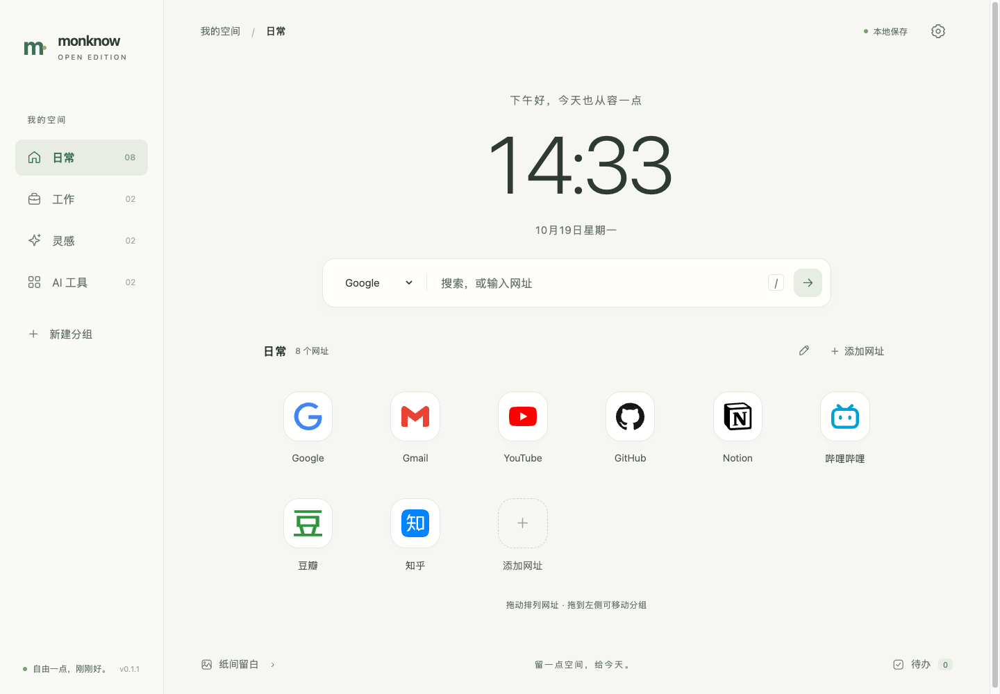

# Open Monknow

[简体中文](README.md) · [MIT License](LICENSE) · [Changelog](CHANGELOG.md)

A quiet, ad-free Chrome new tab with search, grouped shortcuts, wallpapers, a clock, and to-dos. Your data stays in your browser.

This is an independent project, unaffiliated with MONKNOW. [REA](https://github.com/morluto/rea) helped investigate the original extension's entry points and feature scope. The replacement code and backgrounds were written independently; neither the original service nor REA is a runtime dependency.



## Install

The extension is not published in the Chrome Web Store yet.

1. Download **`open-monknow-0.1.1.zip`** from [GitHub Releases](https://github.com/burun/open-monknow/releases/latest) and extract it.
2. Open `chrome://extensions` and enable **Developer mode**.
3. Choose **Load unpacked** and select the **`open-monknow` directory** that directly contains `manifest.json`.
4. Open a new tab. Accept Chrome's new-tab change prompt if shown, and disable another new-tab extension if it takes precedence.

Chrome 120+ is required. Installation needs no Node.js or build step. Keep the loaded directory in place. To update, replace files at the same path, reload the extension, and open a new tab. Export a backup before uninstalling; uninstalling removes extension data. Version 0.1.1 adds the `favicon` permission, which Chrome may ask you to approve.

See the [installation guide](docs/installation.md), also included as `INSTALL.md` inside the package and attached separately to the release. If you use a source ZIP or clone instead, load its `extension` subdirectory. The source archive and the installation package have different layouts.

## Features

- Search with Google, Bing, Baidu, or DuckDuckGo; enter a URL to navigate directly.
- Create, edit, reorder, and move shortcuts between groups; undo deletions.
- Bundled icons for common websites, Chrome favicon resources for other sites, and optional text icons.
- Local-time clock, optional seconds, date, and a personalized greeting.
- Four bundled backgrounds or your own JPG, PNG, or WebP image, resized locally.
- To-dos with completion, removal, and undo.
- Light, dark, and system themes; fluid interface sizing, extra 15% / 30% / 50% scale, and compact layout.
- Validated JSON backups with a replacement preview and confirmation.

`/` or `Cmd/Ctrl + K` focuses search; `Cmd/Ctrl + ,` opens settings; `Esc` closes a panel. The app interface is currently primarily Chinese.

## Privacy and permissions

No accounts, analytics, advertising, remote scripts, or third-party icon service. The extension stores shortcuts, groups, settings, to-dos, and resized wallpapers in `chrome.storage.local`.

| Permission | Purpose |
| --- | --- |
| `storage` | Save local data and reflect changes across new-tab pages |
| `favicon` | Display website icons through Chrome's favicon resources |

There are no broad host, history, bookmarks, or tab-management permissions. Search and link navigation still visit the chosen website. Chrome's own service behavior is controlled by browser settings. See [PRIVACY.md](PRIVACY.md).

Export a JSON backup before changing browsers or uninstalling. Backups contain your saved URLs, to-dos, and wallpaper. Concurrent edits use the last saved state rather than collaborative merging.

## Development

Node.js 22+ is required for development. The core app, checks, tests, and build have no npm dependencies; `npm install` is unnecessary.

```sh
git clone https://github.com/burun/open-monknow.git
cd open-monknow
npm run dev
npm run check
npm test
npm run build
```

The preview runs at `http://127.0.0.1:4173` with separate localStorage data. Chrome-specific favicon resources are only available in the extension. The build produces `dist/open-monknow/` and a versioned ZIP; extract the ZIP before loading. See [development and browser testing](docs/development.md).

Current limits: 50 groups, 500 shortcuts per group, 500 to-dos, and a 15 MB input image resized within 1920×1200. Browser storage quotas still apply. No cloud sync, weather, automatic updates, or import of MONKNOW's proprietary format. Missing browser favicons may show a generic icon.

## Contribute

Report bugs and ideas in [Issues](https://github.com/burun/open-monknow/issues). Read [CONTRIBUTING.md](CONTRIBUTING.md) before a pull request, and use [SECURITY.md](SECURITY.md) for security reports. No response-time or support-period commitment is made.

## License

Original code, backgrounds, and documentation use the [MIT License](LICENSE). Third-party website icons retain their own terms, documented in [THIRD_PARTY_NOTICES.md](THIRD_PARTY_NOTICES.md). Third-party trademark rights are not granted by the MIT license. See [licensing notes](docs/licensing.md).
